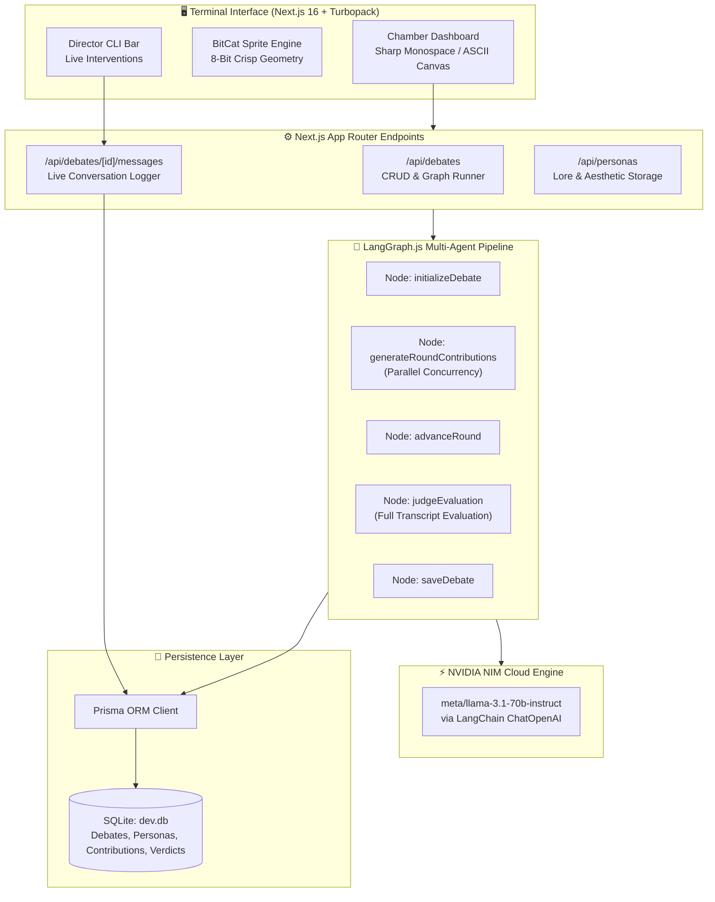

<p align="center">
  <pre align="center">
  ┌───────────────────────────────────────────────┐
  │  ╔═════════════════════════════════════════╗  │
  │  ║          T H E   C O U N C I L          ║  │
  │  ╚═════════════════════════════════════════╝  │
  │               ◆─────◆─────◆                   │
  │         [ 8-BIT MULTI-AGENT ARENA ]           │
  └───────────────────────────────────────────────┘
  </pre>
</p>

<h1 align="center">THE COUNCIL</h1>

<p align="center">
  <strong>Conflicting Minds. Unvarnished Takes. Binding Decrees.</strong>
</p>

<p align="center">
  <em>A Retro-Futuristic Terminal for Multi-Agent AI Deliberation & Instant Decision Arbitrage</em>
</p>

<p align="center">
  
  
  
  
  
  
</p>

---

## ⚡ Overview

**THE COUNCIL** is an autonomous multi-agent deliberation platform engineered as a retro-futuristic Claude Code-inspired ASCII terminal. Users submit dilemmas, strategic crossroads, or engineering debates to a customized council of cognitive alter-egos. 

Instead of sanitized, diplomatic chatbot summaries, **THE COUNCIL** pits opinionated 8-bit bit-cat personas against each other in structured rounds of rapid-fire arguments, direct callouts, and real-time live messaging. Once deliberations conclude, an impartial judicial engine issues a binding, non-hedging decree with tactical action steps.

---

## 🎮 Key Features

- 👾 **Chunky 8-Bit Pixel Bit-Cats**: Procedural 8-bit pixel sprites rendered with crisp square geometry across 7 ear structures, 14 eye/eyewear types, and 11 accessories.
- 🎨 **Modular Dress Closet & Semantic Lore Inference**:
  - Automatically outfits character aesthetics based on their psychological lore and perspective.
  - Interactive 4-category gear closet (`[EARS]`, `[EYES]`, `[ACCESSORY]`, `[PALETTE]`) with instant `[⚡ AUTO_FROM_LORE]` equipping.
- 🧙‍♂️ **4-Step Persona Forge Wizard**:
  - **Step 1 (Identity)**: Name your mind or grab 1-click presets (*The Ruthless Founder*, *The Chaos Creative*, *The Cypherpunk Hacker*).
  - **Step 2 (Lore & Vibe)**: Character movie intro, voice, and traits.
  - **Step 3 (Mental Model)**: Core worldview, argumentative style, and automatic weakness/blindspot inference.
  - **Step 4 (Bit-Cat Drip)**: Live modular pixel closet.
- 🏛️ **Procedural ASCII Terminal Chamber**:
  - Procedural scrolling circuit traces, animated audio status bars, and hexagonal table slab.
  - Rocking pixel scales of justice and real-time deliberation feeds.
- 💬 **Live Conversation Tracking & Director Interventions**:
  - Interactive terminal CLI input bar (`[+] > Message the council... [SEND]`).
  - Real-time conversation logging in SQLite.
  - Director interventions are dynamically fed into subsequent debate rounds and evaluated by the Judge.
- ⚖️ **Anti-Vague Judicial Ruling Engine**:
  - Zero diplomatic hedging or "both sides have merits" AI fluff.
  - Generates clear, unambiguous, binary directives (*"DO NOT build X; build Y within 24 hours"*), asymmetry analysis, and chronological next steps.

---

## 📐 System Architecture



---

## 🕹️ The Deliberation Workflow

```mermaid
sequenceDiagram
    autonumber
    actor Director as User / Director
    participant Chamber as Terminal Chamber UI
    participant API as Messages / Debate API
    participant Graph as LangGraph Orchestrator
    participant Agents as Council Personas (8-Bit)
    participant Judge as Chief Arbitrator
    participant DB as SQLite (Prisma)

    Director->>Chamber: Submit Dilemma & Select Agents
    Chamber->>API: POST /api/debates
    API->>Graph: Invoke StateGraph(debateId, question)
    
    rect rgb(20, 22, 28)
        note over Graph, Agents: ROUND 1: Opening Takes
        Graph->>Agents: Parallel execution (Decisive stance, no hedging)
        Agents-->>DB: Persist Persona Contributions
    end

    opt Director Live Intervention
        Director->>Chamber: Send Directive via CLI Prompt Bar
        Chamber->>API: POST /api/debates/[id]/messages
        API->>DB: Log Contribution (role: 'user', [DIRECTOR])
    end

    rect rgb(20, 22, 28)
        note over Graph, Agents: ROUND 2 & 3: Clash & Rebuttals
        Graph->>DB: Read Full Conversation (including User Directives)
        Graph->>Agents: Rebuttal Prompt (Direct @Name Callouts)
        Agents-->>DB: Persist Rebuttals
    end

    rect rgb(30, 25, 20)
        note over Graph, Judge: FINAL: Judicial Decree
        Graph->>DB: Query Complete Deliberation Transcript
        Graph->>Judge: Arbitrate Winning Logic & Unresolved Tensions
        Judge-->>DB: Persist Binding Verdict
    end

    Graph-->>Chamber: Deliberation Complete
    Chamber-->>Director: Render Actionable Verdict Panel
```



---

## 🗄️ Database Schema

The database is built on **SQLite** managed through **Prisma ORM**:

```prisma
model Persona {
  id                 String   @id @default(cuid())
  name               String
  description        String
  personality        String
  perspective        String
  beliefs            String
  strengths          String
  blindSpots         String
  communicationStyle String
  debateStyle        String
  customInstructions String   @default("") // Contains encoded [AVATAR:{...}] drip metadata
  isEnabled          Boolean  @default(true)
  createdAt          DateTime @default(now())
  updatedAt          DateTime @updatedAt

  debates       DebatePersona[]
  contributions Contribution[]
}

model Debate {
  id           String    @id @default(cuid())
  userQuestion String
  status       String    @default("pending") // pending, in_progress, completed, failed
  model        String    @default("")
  totalRounds  Int       @default(3)
  startedAt    DateTime  @default(now())
  completedAt  DateTime?

  personas      DebatePersona[]
  contributions Contribution[]
  verdict       Verdict?
}

model Contribution {
  id          String   @id @default(cuid())
  debateId    String
  personaId   String?  // Nullable to support direct user/director interventions
  roundNumber Int
  role        String   @default("persona") // persona, judge, user
  content     String
  createdAt   DateTime @default(now())

  debate  Debate   @relation(fields: [debateId], references: [id], onDelete: Cascade)
  persona Persona? @relation(fields: [personaId], references: [id], onDelete: Cascade)
}

model Verdict {
  id                      String   @id @default(cuid())
  debateId                String   @unique
  summary                 String
  recommendation          String
  supportingArguments     String
  opposingArguments       String
  risks                   String
  agreements              String
  unresolvedDisagreements String
  nextSteps               String
  createdAt               DateTime @default(now())

  debate Debate @relation(fields: [debateId], references: [id], onDelete: Cascade)
}
```

---

## 🛠️ Tech Stack

| Layer | Tooling | Purpose |
|---|---|---|
| **Core Framework** | Next.js 16.4 (Turbopack) | Fast React 19 App Router server & client architecture |
| **Language** | TypeScript 5.x | End-to-end type safety |
| **Styling & Theme** | Tailwind CSS 4 | Custom BBS terminal utilities, scanlines, and tactile borders |
| **Agent State Graph** | `@langchain/langgraph` | Stateful multi-round asynchronous execution pipeline |
| **LLM Provider** | NVIDIA NIM Cloud API | High-throughput inference (`meta/llama-3.1-70b-instruct`) |
| **Database & ORM** | Prisma 6 + SQLite | Embedded persistent storage for personas, transcripts, and verdicts |
| **Animations** | Motion (`motion/react`) | 60FPS fluid terminal transitions and indicator pulses |
| **Icons** | Lucide React | Monochromatic tactical UI iconography |

---

## 🚀 Quickstart

### 1. Prerequisites
- **Node.js** ≥ 18.18.0
- **NVIDIA NIM API Key** (obtain free key from [build.nvidia.com](https://build.nvidia.com/))

### 2. Clone & Install
```bash
git clone https://github.com/your-username/The_Council.git
cd The_Council
npm install
```

### 3. Environment Variables
Create a `.env` file in the project root:
```env
# NVIDIA API Credentials
NVIDIA_API_KEY="nvapi-your-key-here"
NVIDIA_MODEL="meta/llama-3.1-70b-instruct"
NVIDIA_BASE_URL="https://integrate.api.nvidia.com/v1"

# Database Configuration
DATABASE_URL="file:./prisma/dev.db"
```

### 4. Initialize Database
```bash
npx prisma generate
npx prisma db push
```

### 5. Run Development Server
```bash
npm run dev
```

Open **`http://localhost:3000`** in your browser.

---

## 📁 Repository Structure

```
The_Council/
├── prisma/
│   ├── dev.db                      # Local SQLite database
│   └── schema.prisma               # Prisma models (Debates, Personas, Contributions)
├── src/
│   ├── agents/
│   │   ├── judge-agent.ts          # Judicial synthesis & JSON extraction
│   │   ├── persona-agent.ts        # Persona round executor
│   │   └── prompts.ts              # Non-hedging prompt templates
│   ├── app/
│   │   ├── api/
│   │   │   ├── debates/            # Debate run & poll endpoints
│   │   │   │   └── [id]/messages/  # Live conversation logger
│   │   │   └── personas/           # Persona REST endpoints
│   │   ├── debates/
│   │   │   ├── [id]/page.tsx       # Live terminal chamber
│   │   │   ├── new/page.tsx        # Debate configurator
│   │   │   └── page.tsx            # Deliberation archive
│   │   ├── personas/page.tsx       # Persona studio & closet
│   │   ├── globals.css             # Terminal scanlines, scrollbars, colors
│   │   └── page.tsx                # Dashboard hub
│   ├── components/
│   │   ├── council/
│   │   │   ├── blob-avatar.tsx     # Chunky 8-bit pixel cat engine
│   │   │   ├── chat-bubble.tsx     # Monospace chat bubble & user tags
│   │   │   ├── council-chamber.tsx # Real-time deliberation feed & CLI prompt
│   │   │   └── council-table-art.tsx # Hexagonal table & circuit ASCII art
│   │   ├── personas/
│   │   │   ├── avatar-dress-customizer.tsx # 4-category modular gear closet
│   │   │   └── persona-form.tsx    # 4-step persona wizard
│   │   └── verdict/
│   │       └── verdict-panel.tsx   # Actionable decree UI
│   ├── graph/
│   │   ├── nodes.ts                # LangGraph nodes
│   │   ├── state.ts                # State annotation definitions
│   │   └── workflow.ts             # Compiled deliberation graph
│   ├── lib/
│   │   ├── nvidia/client.ts        # NVIDIA NIM LangChain integration
│   │   └── personas/aesthetics.ts  # Semantic lore inference & dress engine
│   └── types/index.ts              # TypeScript interfaces
└── README.md
```

---

## 📜 License

MIT License. Crafted for builders who appreciate pixel aesthetics and ruthless clarity.
