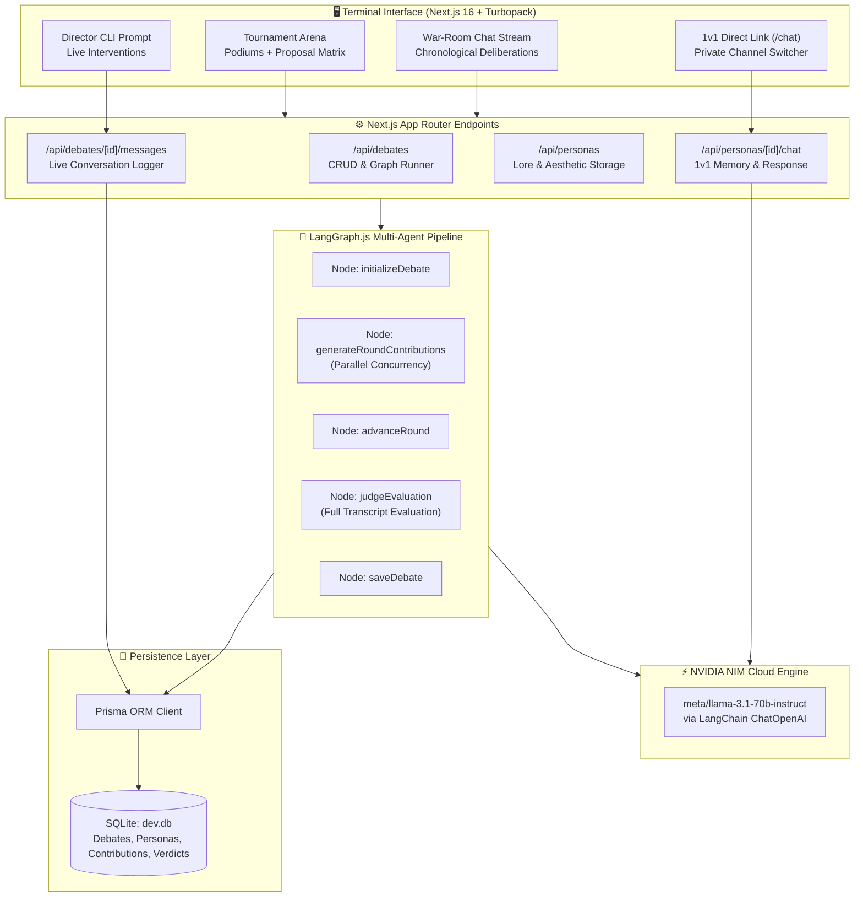

<p align="center">
  <pre align="center">
  ┌────────────────────────────────────────────────────────┐
  │  ╔══════════════════════════════════════════════════╗  │
  │  ║              T H E   C O U N C I L               ║  │
  │  ╚══════════════════════════════════════════════════╝  │
  │                   ◆─────◆─────◆                        │
  │         [ 8-BIT TOURNAMENT DELIBERATION ARENA ]         │
  └────────────────────────────────────────────────────────┘
  </pre>
</p>

<h1 align="center">THE COUNCIL</h1>

<p align="center">
  <strong>Conflicting Minds. Elimination Bracket. One Crowned Blueprint.</strong>
</p>

<p align="center">
  <em>A Retro-Futuristic Terminal for Multi-Agent Deliberation Tournaments & 1v1 Direct Persona Channels</em>
</p>

<p align="center">
  
  
  
  
  
  
  
</p>

---

## ⚡ Overview

**THE COUNCIL** is an autonomous multi-agent decision platform styled as a tactile, Claude Code & Teenage Engineering-inspired ASCII terminal. Instead of asking a single AI for generic advice, users pit customized cognitive alter-egos against each other in structured, competitive deliberation tournaments.

Ditching polite corporate consensus and "both sides have merit" hedging, **THE COUNCIL** runs a rigorous **Proposal → Peer Scoring (1–10) → Elimination → Winning Blueprint** game loop. An impartial Chief Arbitrator evaluates the surviving proposals and outputs a binding, non-hedging directive with an exact execution checklist.

The platform also includes a dedicated **1v1 Direct Terminal Link** to converse privately with any persona without group noise.

---

## 🎮 Key Features

### 1. 🏆 Tournament Deliberation & Elimination Matrix
- **Stage 1 (Pitch Proposals)**: Each mind submits a named, tangible strategy (`[PROPOSAL: "Title"]`) with exact scopes, timelines, and leverage points.
- **Stage 2 (Peer Review & Fatal Flaws)**: Members audit rival plans, award 1–10 scores (`@Target [SCORE: X/10]`), and ruthlessly expose fatal blind spots.
- **Stage 3 (Harden Survivors)**: Surviving contenders battle head-to-head, patch vulnerabilities, and state proof milestones.
- **Stage 4 (Chief Arbitrator's Decree)**: Crowns **one winning strategy**, documents why rival ideas were eliminated, and provides a chronological `0-12h`, `12-24h`, and `48h` action checklist.

### 2. 🏛️ Dual-Pane Arena & Podium Telemetry
- **Active Deliberation Podiums (Left)**: Real-time arena tracking seated vs. active speaker states (`[SEATED]` vs `[PITCHING]`) with animated radar scanlines and speaker spotlights.
- **Live Proposal Standings Matrix (Right)**: Automatically extracts proposals, updates average peer scores, strikes through `[ELIMINATED]` plans in red, and highlights front-runners in green.
- **Fatal Flaw Audit Log**: Right sidebar displays a live feed of inter-agent attacks (`Attacker ⚔️ Target [SCORE: X/10]: Flaw summary`).

### 3. 💬 1v1 Direct Encrypted Channel (`/chat`)
- Dedicated private terminal route to talk directly to any single agent without council noise.
- Channel switcher to toggle between personas instantly.
- Maintains multi-turn conversation memory via NVIDIA NIM while enforcing raw, authentic character voice.

### 4. 🧙‍♂️ 4-Step Character Forge Wizard
- Replaced cumbersome enterprise forms with an intuitive creation wizard:
  - **Step 1 (Identity)**: Alter-ego naming + **3 instant one-click presets** (*The Ruthless Founder*, *The Chaos Creative*, *The Cypherpunk Hacker*).
  - **Step 2 (Lore & Vibe)**: Character movie intro, voice, and traits.
  - **Step 3 (Mental Model)**: Guiding worldview and attack strategy. Auto-populates weaknesses and blindspots.
  - **Step 4 (Bit-Cat Drip)**: Live modular pixel closet.

### 5. 👾 Chunky 8-Bit Bit-Cats & Modular Drip Closet
- Authentic retro arcade pixel sprites (`shapeRendering="crispEdges"`) across 7 ear structures, 14 eyes/eyewear, and 11 accessories.
- **Automatic Lore Inference Engine**: Semantically parses written lore to equip fitting gear (Founder Crown, Cyberplate, Hacker Frames, Top Hat, Samurai Bandana, etc.).
- Modular closet tabs (`[EARS]`, `[EYES]`, `[ACCESSORY]`, `[PALETTE]`) + `[⚡ AUTO_FROM_LORE]` instant gear synthesis.

### 6. 📡 Real-Time Director Interventions
- Live CLI prompt bar (`[+] > Message the council... [SEND]`) in the active chamber.
- Interventions are logged as `[YOU // DIRECTOR]` with cyan cyber badges and dynamically fed into subsequent debate rounds and the Judge's evaluation.

---

## 📐 System Architecture



---

## 🕹️ The Tournament Protocol

```mermaid
sequenceDiagram
    autonumber
    actor Director as User / Director
    participant Chamber as Tournament Arena UI
    participant API as Messages / Debate API
    participant Graph as LangGraph Orchestrator
    participant Agents as Council Personas (8-Bit)
    participant Judge as Chief Arbitrator
    participant DB as SQLite (Prisma)

    Director->>Chamber: Submit Dilemma & Select Minds
    Chamber->>API: POST /api/debates
    API->>Graph: Invoke StateGraph(debateId, question)
    
    rect rgb(20, 22, 28)
        note over Graph, Agents: STAGE 01: Pitch Proposals
        Graph->>Agents: Generate [PROPOSAL: "Title"] (Concrete scope & leverage)
        Agents-->>DB: Persist Stage 1 Proposals
    end

    opt Director Live Intervention
        Director->>Chamber: Send Directive via CLI Prompt Bar
        Chamber->>API: POST /api/debates/[id]/messages
        API->>DB: Log Contribution (role: 'user', [DIRECTOR])
    end

    rect rgb(20, 22, 28)
        note over Graph, Agents: STAGE 02: Peer Audit & Scoring
        Graph->>DB: Read Proposals & User Directives
        Graph->>Agents: Review Rivals, assign @Target [SCORE: X/10], expose fatal flaws
        Agents-->>DB: Persist Fatal Flaw Audits
    end

    rect rgb(20, 22, 28)
        note over Graph, Agents: STAGE 03: Harden Survivors
        Graph->>DB: Read Audits & Filter Eliminated Proposals
        Graph->>Agents: Defend surviving proposals & establish proving milestones
        Agents-->>DB: Persist Hardened Takes
    end

    rect rgb(30, 25, 20)
        note over Graph, Judge: STAGE 04: Chief Arbitrator's Decree
        Graph->>DB: Query Complete Transcript
        Graph->>Judge: Crown Winning Strategy, explain eliminated plans, issue checklist
        Judge-->>DB: Persist Binding Decree
    end

    Graph-->>Chamber: Deliberation Complete
    Chamber-->>Director: Render Actionable Blueprint Panel
```



---

## 🗄️ Database Schema

Managed via **Prisma ORM** over embedded **SQLite**:

```prisma
model Persona {
  id                 String   @id @default(cuid())
  name               String
  description        String
  personality        String
  perspective        String
  beliefs            String
  strengths          String
  blindSpots         String
  communicationStyle String
  debateStyle        String
  customInstructions String   @default("") // Encodes [AVATAR:{...}] gear configuration
  isEnabled          Boolean  @default(true)
  createdAt          DateTime @default(now())
  updatedAt          DateTime @updatedAt

  debates       DebatePersona[]
  contributions Contribution[]
}

model Debate {
  id           String    @id @default(cuid())
  userQuestion String
  status       String    @default("pending") // pending, in_progress, completed, failed
  model        String    @default("")
  totalRounds  Int       @default(3)
  startedAt    DateTime  @default(now())
  completedAt  DateTime?

  personas      DebatePersona[]
  contributions Contribution[]
  verdict       Verdict?
}

model Contribution {
  id          String   @id @default(cuid())
  debateId    String
  personaId   String?  // Nullable to support direct user/director interventions
  roundNumber Int
  role        String   @default("persona") // persona, judge, user
  content     String
  createdAt   DateTime @default(now())

  debate  Debate   @relation(fields: [debateId], references: [id], onDelete: Cascade)
  persona Persona? @relation(fields: [personaId], references: [id], onDelete: Cascade)
}

model Verdict {
  id                      String   @id @default(cuid())
  debateId                String   @unique
  summary                 String
  recommendation          String
  supportingArguments     String
  opposingArguments       String
  risks                   String
  agreements              String
  unresolvedDisagreements String
  nextSteps               String
  createdAt               DateTime @default(now())

  debate Debate @relation(fields: [debateId], references: [id], onDelete: Cascade)
}
```

---

## 🛠️ Tech Stack & Metrics

| Component | Tooling | Purpose |
|---|---|---|
| **Framework** | Next.js 16.4 (Turbopack) | React 19 App Router server and client architecture |
| **Language** | TypeScript 5.x | 100% strict type safety across the entire stack |
| **Theme & UI** | Tailwind CSS 4 | Custom BBS terminal utilities, scanlines, and tactile borders |
| **Agent State Graph** | `@langchain/langgraph` | Stateful multi-round asynchronous execution pipeline |
| **Inference Engine** | NVIDIA NIM Cloud API | High-throughput model execution (`meta/llama-3.1-70b-instruct`) |
| **Database & ORM** | Prisma 6 + SQLite | Embedded persistent storage for personas, transcripts, and verdicts |
| **Animations** | Motion (`motion/react`) | 60FPS fluid terminal transitions and indicator pulses |
| **Icons** | Lucide React | Monochromatic tactical UI iconography |
| **Codebase Size** | **~6,324 LOC** | Custom TypeScript, React, and CSS code |

---

## 🚀 Quickstart

### 1. Prerequisites
- **Node.js** ≥ 18.18.0
- **NVIDIA NIM API Key** (obtain free key from [build.nvidia.com](https://build.nvidia.com/))

### 2. Clone & Install
```bash
git clone https://github.com/your-username/The_Council.git
cd The_Council
npm install
```

### 3. Environment Variables
Create `.env` in the project root:
```env
# NVIDIA API Credentials
NVIDIA_API_KEY="nvapi-your-key-here"
NVIDIA_MODEL="meta/llama-3.1-70b-instruct"
NVIDIA_BASE_URL="https://integrate.api.nvidia.com/v1"

# Database Configuration
DATABASE_URL="file:./prisma/dev.db"
```

### 4. Initialize Database
```bash
npx prisma generate
npx prisma db push
```

### 5. Launch Terminal
```bash
npm run dev
```

Open **`http://localhost:3000`** in your browser.

---

## 📁 Repository Structure

```
The_Council/
├── prisma/
│   ├── dev.db                      # Local SQLite database
│   └── schema.prisma               # Prisma models (Debates, Personas, Contributions)
├── src/
│   ├── agents/
│   │   ├── judge-agent.ts          # Judicial synthesis & JSON extraction
│   │   ├── persona-agent.ts        # Persona round executor
│   │   └── prompts.ts              # Tournament protocol prompt templates
│   ├── app/
│   │   ├── api/
│   │   │   ├── debates/            # Debate run & poll endpoints
│   │   │   │   └── [id]/messages/  # Live conversation logger
│   │   │   └── personas/           # Persona REST endpoints
│   │   │       └── [id]/chat/      # 1v1 direct encrypted channel endpoint
│   │   ├── chat/page.tsx           # Dedicated 1v1 direct chat page
│   │   ├── debates/
│   │   │   ├── [id]/page.tsx       # Live tournament chamber
│   │   │   ├── new/page.tsx        # Tournament configurator
│   │   │   └── page.tsx            # Deliberation archive
│   │   ├── personas/page.tsx       # Persona studio & closet
│   │   ├── globals.css             # Terminal scanlines, scrollbars, colors
│   │   └── page.tsx                # Dashboard hub
│   ├── components/
│   │   ├── council/
│   │   │   ├── blob-avatar.tsx     # Chunky 8-bit pixel cat engine
│   │   │   ├── chat-bubble.tsx     # Monospace chat bubble & user tags
│   │   │   ├── council-chamber.tsx # Real-time deliberation feed & CLI prompt
│   │   │   ├── council-table-art.tsx # Deliberation podiums & proposal matrix
│   │   │   └── debate-sidebar-telemetry.tsx # Fatal flaw audit feed & stage tracker
│   │   ├── layout/
│   │   │   ├── header.tsx          # Top terminal status bar
│   │   │   └── sidebar.tsx         # Tactile navigation (Debate, 1v1, Personas)
│   │   ├── personas/
│   │   │   ├── avatar-dress-customizer.tsx # 4-category modular gear closet
│   │   │   └── persona-form.tsx    # 4-step persona wizard with presets
│   │   └── verdict/
│   │       └── verdict-panel.tsx   # Crowned strategy & checklist UI
│   ├── graph/
│   │   ├── nodes.ts                # LangGraph nodes
│   │   ├── state.ts                # State annotation definitions
│   │   └── workflow.ts             # Compiled deliberation graph
│   ├── lib/
│   │   ├── nvidia/client.ts        # NVIDIA NIM LangChain integration
│   │   └── personas/aesthetics.ts  # Semantic lore inference & dress engine
│   └── types/index.ts              # TypeScript interfaces
└── README.md
```

---

## 📜 License

MIT License. Built for thinkers who demand pixel precision and decisive clarity.
