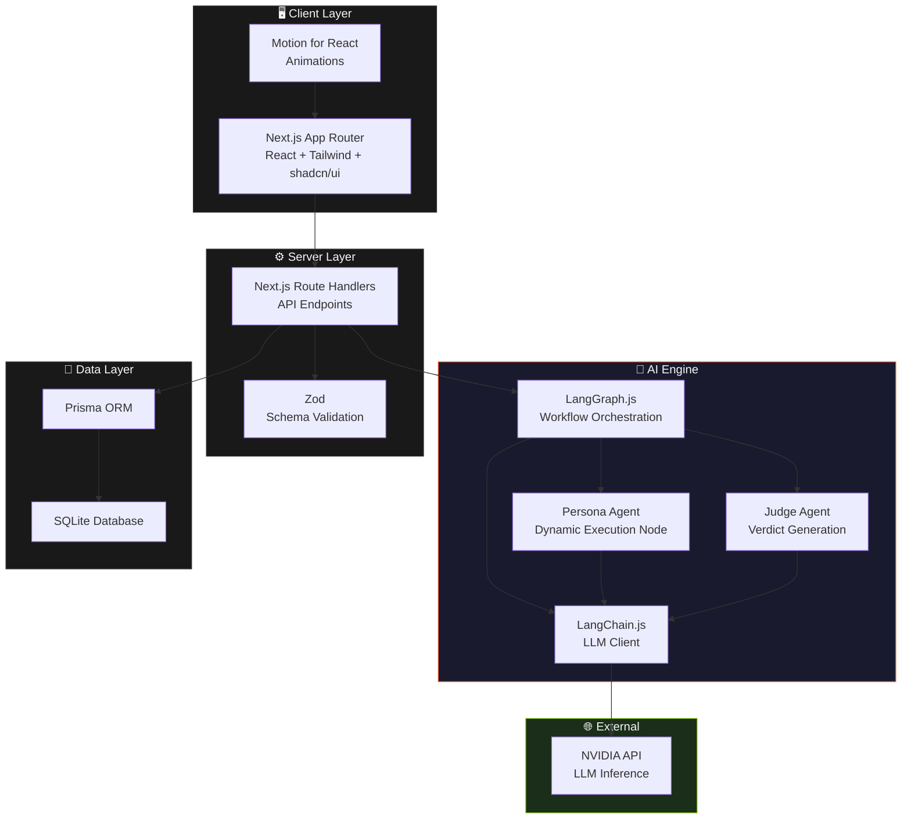
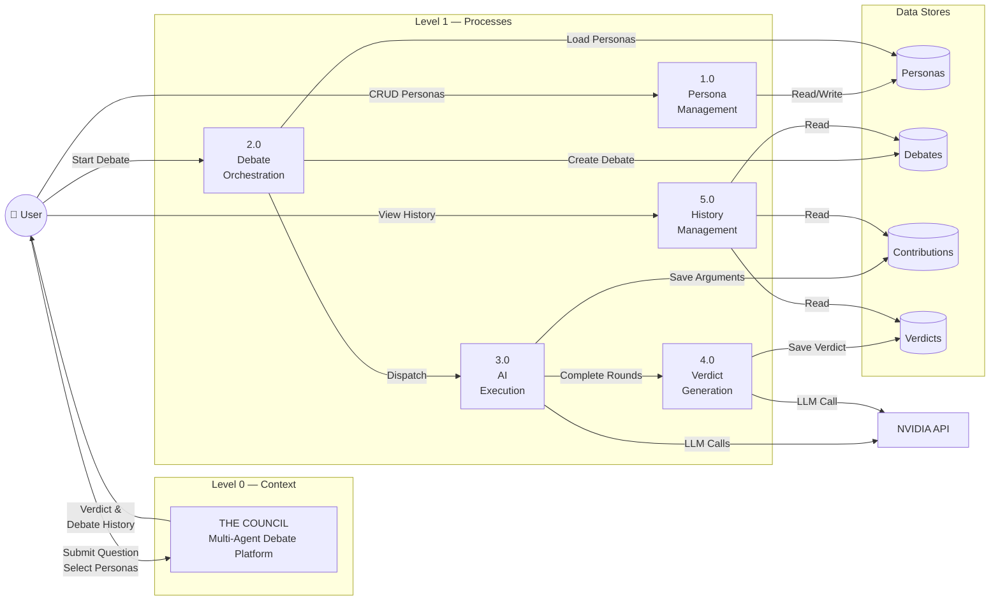
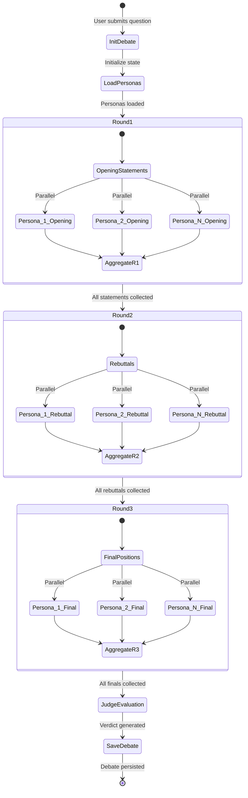
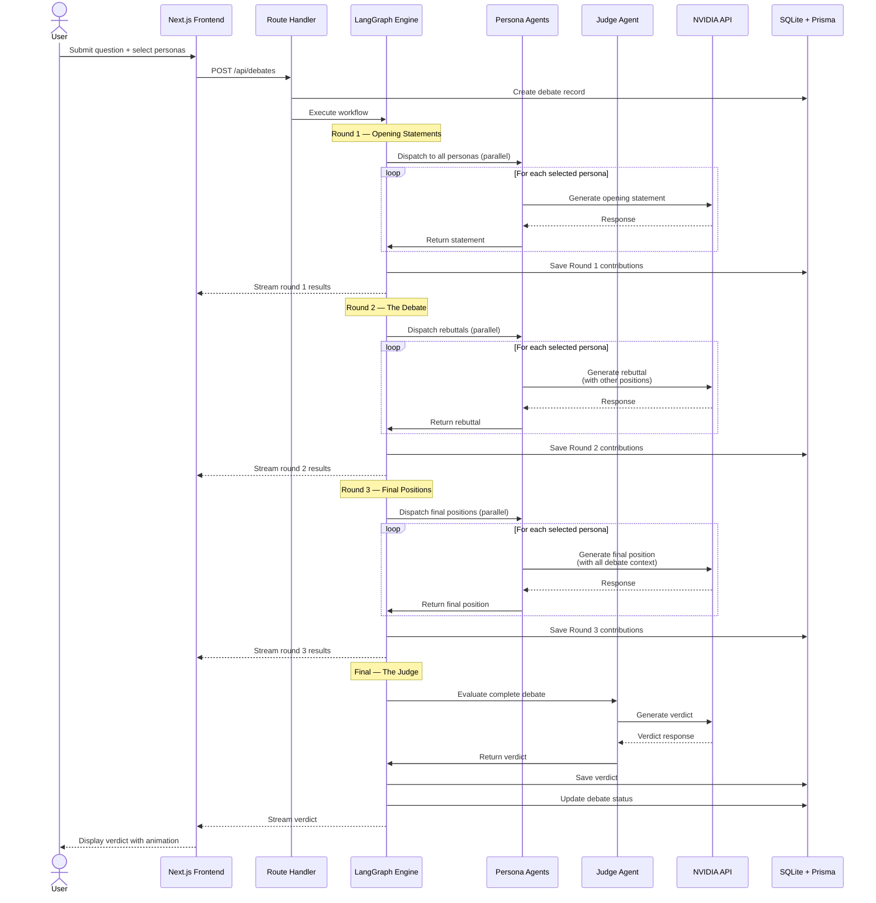
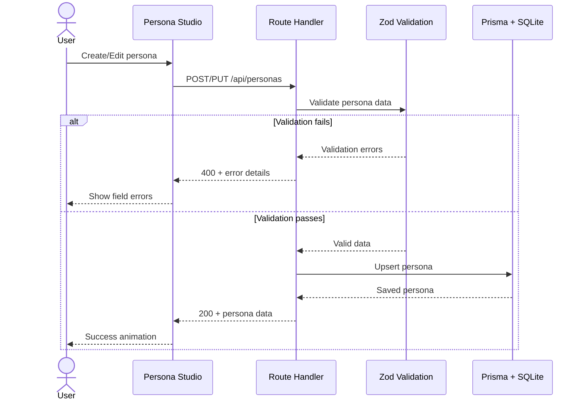
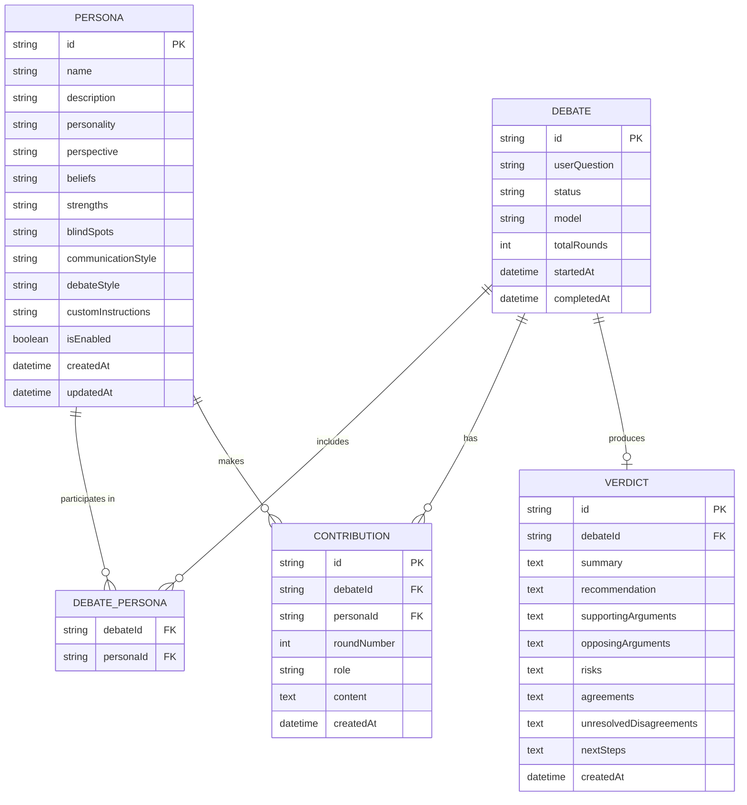
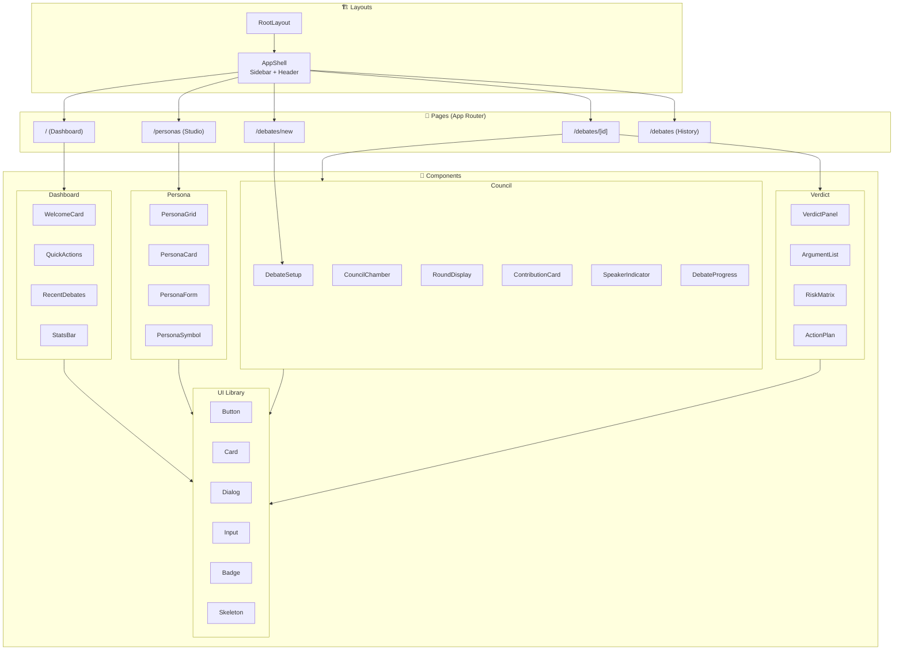
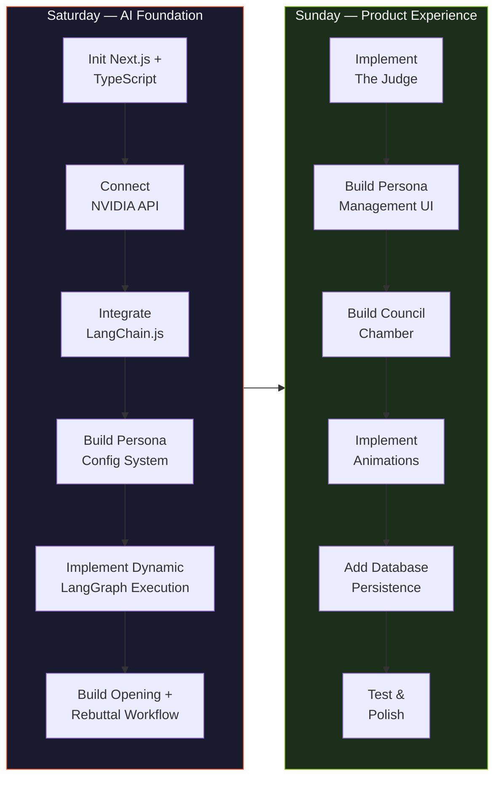

<p align="center">
  
</p>

<h1 align="center">THE COUNCIL</h1>

<p align="center">
  <strong>Different Minds. Conflicting Perspectives. One Verdict.</strong>
</p>

<p align="center">
  <em>A Multi-Agent AI Debate & Decision Platform</em>
</p>

<p align="center">
  
  
  
  
  
</p>

---

## Table of Contents

- [Overview](#overview)
- [Key Features](#key-features)
- [Architecture](#architecture)
  - [System Architecture](#system-architecture)
  - [Data Flow Diagram](#data-flow-diagram)
  - [LangGraph Workflow](#langgraph-workflow)
  - [Sequence Diagrams](#sequence-diagrams)
  - [Entity Relationship Diagram](#entity-relationship-diagram)
  - [Component Architecture](#component-architecture)
- [Technology Stack](#technology-stack)
- [Project Structure](#project-structure)
- [Getting Started](#getting-started)
  - [Prerequisites](#prerequisites)
  - [Installation](#installation)
  - [Environment Variables](#environment-variables)
  - [Database Setup](#database-setup)
  - [Running the Application](#running-the-application)
- [Dynamic Persona System](#dynamic-persona-system)
  - [Persona Fields](#persona-fields)
  - [Persona Management](#persona-management)
- [Debate Engine](#debate-engine)
  - [Debate Rounds](#debate-rounds)
  - [The Judge](#the-judge)
- [UI/UX Design](#uiux-design)
  - [Design Philosophy](#design-philosophy)
  - [Color Palette](#color-palette)
  - [Typography](#typography)
  - [Animation System](#animation-system)
- [Application Screens](#application-screens)
- [Gamification](#gamification)
- [API Reference](#api-reference)
- [MVP Scope](#mvp-scope)
- [Development Roadmap](#development-roadmap)
- [License](#license)

---

## Overview

THE COUNCIL is not another AI chatbot. It is a modular multi-agent AI platform where users create different AI personalities — representing different perspectives, mindsets, philosophies and ways of thinking — and pit them against each other in structured debates.

Users submit a question, idea, problem or decision. Their selected personas independently analyze the situation, debate each other, challenge arguments and eventually submit their conclusions to a Judge who evaluates the discussion and produces a final verdict.

The central idea is to **simulate different versions of the user's thinking:**

| Persona | Archetype |
|---------|-----------|
| Ambitious Me | The visionary who sees possibility |
| Logical Me | The analyst who demands evidence |
| Future Me | The strategist thinking long-term |
| Lazy Me | The pragmatist who finds the easiest path |
| Brutally Honest Me | The critic who exposes blind spots |
| Creative Me | The lateral thinker who reframes problems |
| Risk-Taking Me | The adventurer who embraces uncertainty |
| Financially Minded Me | The economist who counts every cost |

Users can create **unlimited** custom personas. Adding a persona never requires modifying the underlying system architecture.

**Think differently. Decide better.**

---

## Key Features

- 🧠 **Dynamic Persona System** — Create, edit, duplicate and manage unlimited AI personalities
- ⚔️ **Structured Debates** — Multi-round arguments with opening statements, rebuttals and final positions
- ⚖️ **Independent Judge** — AI evaluator that assesses argument quality, not popularity
- 🔄 **LangGraph Workflow** — Scalable graph-based execution supporting any number of participants
- 🎮 **Gamification** — Achievements, progress tracking and verdict reveals
- 🎨 **Premium UI** — Nothing-inspired × Swiss Style × Strategy Game aesthetic
- 💾 **Persistent History** — All debates saved and reviewable
- ⚡ **NVIDIA-Powered** — Enterprise-grade AI inference via NVIDIA API

---

## Architecture

### System Architecture



### Data Flow Diagram



### LangGraph Workflow



### Sequence Diagrams

#### Full Debate Flow



#### Persona CRUD Flow



### Entity Relationship Diagram



### Component Architecture



---

## Technology Stack

| Layer | Technology | Purpose |
|-------|-----------|---------|
| **Framework** | Next.js 15 (App Router) | Full-stack React framework |
| **Language** | TypeScript 5.x | Type safety everywhere |
| **UI Library** | React 19 | Component model |
| **Styling** | Tailwind CSS 4 | Utility-first CSS |
| **Components** | shadcn/ui | Accessible component primitives |
| **Animation** | Motion for React | Performant animations |
| **AI Client** | LangChain.js | LLM abstraction layer |
| **AI Orchestration** | LangGraph.js | Multi-agent workflow engine |
| **LLM Provider** | NVIDIA API | AI inference |
| **ORM** | Prisma | Type-safe database client |
| **Database** | SQLite | Embedded relational database |
| **Validation** | Zod | Runtime schema validation |
| **Icons** | Lucide Icons | Consistent iconography |

---

## Project Structure

```
the-council/
├── prisma/
│   └── schema.prisma              # Database schema
│
├── src/
│   ├── app/                       # Next.js App Router
│   │   ├── layout.tsx             # Root layout
│   │   ├── page.tsx               # Dashboard
│   │   ├── globals.css            # Global styles
│   │   ├── personas/
│   │   │   └── page.tsx           # Persona Studio
│   │   ├── debates/
│   │   │   ├── page.tsx           # Debate History
│   │   │   ├── new/
│   │   │   │   └── page.tsx       # New Debate Setup
│   │   │   └── [id]/
│   │   │       └── page.tsx       # Council Chamber + Verdict
│   │   └── api/
│   │       ├── personas/
│   │       │   ├── route.ts       # GET all, POST create
│   │       │   └── [id]/
│   │       │       └── route.ts   # GET, PUT, DELETE by ID
│   │       └── debates/
│   │           ├── route.ts       # GET all, POST create + run
│   │           └── [id]/
│   │               └── route.ts   # GET debate by ID
│   │
│   ├── components/
│   │   ├── layout/
│   │   │   ├── app-shell.tsx      # Main app layout
│   │   │   ├── sidebar.tsx        # Navigation sidebar
│   │   │   └── header.tsx         # Top header bar
│   │   ├── dashboard/
│   │   │   ├── welcome-card.tsx
│   │   │   ├── quick-actions.tsx
│   │   │   ├── recent-debates.tsx
│   │   │   └── stats-bar.tsx
│   │   ├── personas/
│   │   │   ├── persona-grid.tsx
│   │   │   ├── persona-card.tsx
│   │   │   ├── persona-form.tsx
│   │   │   └── persona-symbol.tsx
│   │   ├── council/
│   │   │   ├── debate-setup.tsx
│   │   │   ├── council-chamber.tsx
│   │   │   ├── round-display.tsx
│   │   │   ├── contribution-card.tsx
│   │   │   └── debate-progress.tsx
│   │   ├── verdict/
│   │   │   ├── verdict-panel.tsx
│   │   │   ├── argument-list.tsx
│   │   │   └── action-plan.tsx
│   │   └── ui/                    # shadcn/ui components
│   │       ├── button.tsx
│   │       ├── card.tsx
│   │       ├── dialog.tsx
│   │       ├── input.tsx
│   │       ├── textarea.tsx
│   │       ├── badge.tsx
│   │       ├── skeleton.tsx
│   │       └── ...
│   │
│   ├── agents/
│   │   ├── persona-agent.ts       # Reusable persona execution
│   │   ├── judge-agent.ts         # Judge evaluation logic
│   │   └── prompts.ts             # System prompt templates
│   │
│   ├── graph/
│   │   ├── state.ts               # LangGraph shared state
│   │   ├── nodes.ts               # Graph node definitions
│   │   └── workflow.ts            # Complete workflow assembly
│   │
│   ├── lib/
│   │   ├── nvidia/
│   │   │   └── client.ts          # NVIDIA API client config
│   │   ├── database/
│   │   │   └── prisma.ts          # Prisma client singleton
│   │   ├── validation/
│   │   │   └── schemas.ts         # Zod validation schemas
│   │   └── animations/
│   │       └── variants.ts        # Motion animation variants
│   │
│   └── types/
│       └── index.ts               # Shared TypeScript types
│
├── docs/
│   └── assets/
│       └── council-logo.svg       # Logo asset
│
├── .env.example                   # Environment variable template
├── .gitignore
├── next.config.ts                 # Next.js configuration
├── tailwind.config.ts             # Tailwind configuration
├── tsconfig.json                  # TypeScript configuration
├── package.json
└── README.md                      # This file
```

---

## Getting Started

### Prerequisites

- **Node.js** ≥ 18.0
- **npm** or **pnpm**
- **NVIDIA API Key** — Obtain from [NVIDIA AI Foundation Models](https://build.nvidia.com/)

### Installation

```bash
# Clone the repository
git clone https://github.com/your-username/the-council.git
cd the-council

# Install dependencies
npm install

# Set up environment variables
cp .env.example .env
# Edit .env with your NVIDIA API key
```

### Environment Variables

```env
# NVIDIA API Configuration
NVIDIA_API_KEY=your_nvidia_api_key_here
NVIDIA_MODEL=meta/llama-3.1-70b-instruct
NVIDIA_BASE_URL=https://integrate.api.nvidia.com/v1

# Database
DATABASE_URL="file:./dev.db"

# Application
NEXT_PUBLIC_APP_NAME="THE COUNCIL"
```

### Database Setup

```bash
# Generate Prisma client
npx prisma generate

# Run migrations
npx prisma db push

# (Optional) Seed with default personas
npx prisma db seed
```

### Running the Application

```bash
# Development
npm run dev

# Production build
npm run build
npm run start
```

Open [http://localhost:3000](http://localhost:3000) to access THE COUNCIL.

---

## Dynamic Persona System

### Persona Fields

Every persona is a **dynamic configuration** — not a hardcoded agent. The same underlying LLM receives different system instructions based on persona attributes:

| Field | Description | Example |
|-------|-------------|---------|
| **Name** | Persona identity | "Ambitious Me" |
| **Description** | Short introduction | "The version of you that aims for the stars" |
| **Personality** | Character traits | "Driven, optimistic, competitive" |
| **Perspective** | Way of analyzing problems | "Every problem is an opportunity in disguise" |
| **Beliefs** | Guiding principles | "Growth requires discomfort" |
| **Strengths** | Areas of focus | "Identifying opportunity, motivating action" |
| **Blind Spots** | Common weaknesses | "May underestimate risks and costs" |
| **Communication Style** | Way of speaking | "Energetic, forward-looking, uses power words" |
| **Debate Style** | Way of challenging others | "Challenges pessimism, reframes constraints" |
| **Custom Instructions** | Additional behavior rules | "Always suggest at least one bold option" |

### Persona Management

Users can:
- ✅ **Create** new personas with full customization
- ✏️ **Edit** existing persona configurations
- 📋 **Duplicate** personas as starting templates
- 🗑️ **Delete** personas they no longer need
- 🔘 **Enable/Disable** personas without deleting them
- 🎯 **Select** any combination for a debate

---

## Debate Engine

### Debate Rounds

```
┌─────────────────────────────────────────────────────┐
│                                                     │
│  ROUND 01 ─── Opening Statements                   │
│  Each persona independently analyzes the question   │
│  and presents their initial position.               │
│                                                     │
│  ROUND 02 ─── The Debate                           │
│  Personas receive others' positions and challenge   │
│  their arguments with rebuttals.                    │
│                                                     │
│  ROUND 03 ─── Final Positions                      │
│  Personas respond to objections and summarize       │
│  their final stance. May change their mind.         │
│                                                     │
│  FINAL ────── The Judge                             │
│  Independent evaluation of all arguments.           │
│  Quality over popularity.                           │
│                                                     │
└─────────────────────────────────────────────────────┘
```

### The Judge

The Judge is a dedicated role — separate from debate participants. It does **not** automatically support the majority. Instead, it evaluates:

| Output | Description |
|--------|-------------|
| **Final Verdict** | The judge's decision |
| **Decision Summary** | Concise reasoning |
| **Supporting Arguments** | Strongest points in favor |
| **Opposing Arguments** | Strongest counterpoints |
| **Risks & Opportunities** | What could go right or wrong |
| **Points of Agreement** | Where personas aligned |
| **Unresolved Disagreements** | Outstanding conflicts |
| **Recommended Action Plan** | Concrete next steps |

---

## UI/UX Design

### Design Philosophy

Three design influences blended:

1. **Nothing-inspired design** — Clean hardware aesthetics, dot-matrix patterns
2. **Swiss International Style** — Grid systems, strong typography, alignment
3. **Minimalist gamified interfaces** — Achievement systems, progress indicators

> **Design principle: 90% minimal, 10% playful.**

### Color Palette

#### Dark Mode (Default)

| Token | Hex | Usage |
|-------|-----|-------|
| Background | `#111111` | Page background |
| Surface | `#191919` | Card backgrounds |
| Elevated | `#222222` | Modals, dropdowns |
| Primary Text | `#F5F5F5` | Headings, body |
| Secondary Text | `#929292` | Labels, hints |
| Border | `#303030` | Dividers, outlines |
| Accent | `#FF5722` | Highlights, CTAs |

#### Light Mode

| Token | Hex | Usage |
|-------|-----|-------|
| Background | `#F5F5F2` | Page background |
| Surface | `#FFFFFF` | Card backgrounds |
| Primary Text | `#171717` | Headings, body |
| Secondary Text | `#777777` | Labels, hints |
| Border | `#E5E5E1` | Dividers, outlines |
| Accent | `#FF5722` | Highlights, CTAs |

### Typography

- **Primary Font:** Geist (with Inter fallback)
- **Monospace:** Geist Mono (for round numbers, statistics)
- Large editorial headings for section titles
- Small uppercase labels (`ROUND 01`, `VERDICT`, `PERSONA STUDIO`)
- Strong typographic hierarchy across all screens

### Animation System

| Interaction | Behavior |
|-------------|----------|
| Page transitions | Fade + slight Y-axis movement |
| Persona cards | Subtle hover lift (translateY) |
| Persona selection | Border + background color transition |
| Debate start | Sequential persona activation |
| Agent thinking | Pulsing dot indicator |
| Agent response | Smooth message reveal (height + opacity) |
| Round progression | Animated horizontal progress line |
| Verdict reveal | Restrained scale + fade entrance |
| Achievement unlock | Brief celebratory micro-animation |

All animations respect `prefers-reduced-motion`.

---

## Application Screens

| # | Screen | Route | Purpose |
|---|--------|-------|---------|
| 1 | **Headquarters** | `/` | Dashboard with quick actions |
| 2 | **Persona Studio** | `/personas` | Create and manage AI personalities |
| 3 | **New Debate** | `/debates/new` | Configure and launch a debate |
| 4 | **Council Chamber** | `/debates/[id]` | Live debate experience |
| 5 | **Final Verdict** | `/debates/[id]#verdict` | Judge's decision display |
| 6 | **Debate History** | `/debates` | Browse past debates |

---

## Gamification

### Achievements (MVP)

| Achievement | Trigger |
|-------------|---------|
| 🏛️ First Session | Complete your first debate |
| 🧠 Five Minds | Create 5 personas |
| ⚔️ Ten Debates | Complete 10 debates |
| 🤝 Unanimous | All personas reach the same conclusion |
| 💥 Major Disagreement | Personas fundamentally disagree |

### Visual Identity

- Each persona receives a unique **geometric symbol** generated from its name
- **Dot-matrix patterns** used as subtle background textures
- **Numbered round indicators** in monospaced type
- **Progress lines** that animate between debate stages

---

## API Reference

### Personas

| Method | Endpoint | Description |
|--------|----------|-------------|
| `GET` | `/api/personas` | List all personas |
| `POST` | `/api/personas` | Create a persona |
| `GET` | `/api/personas/[id]` | Get a persona |
| `PUT` | `/api/personas/[id]` | Update a persona |
| `DELETE` | `/api/personas/[id]` | Delete a persona |

### Debates

| Method | Endpoint | Description |
|--------|----------|-------------|
| `GET` | `/api/debates` | List all debates |
| `POST` | `/api/debates` | Create and run a debate |
| `GET` | `/api/debates/[id]` | Get debate details + verdict |

---

## MVP Scope

### ✅ Must Have

- [x] Dynamic persona creation and editing
- [x] Persona persistence (SQLite + Prisma)
- [x] Multiple selected participants
- [x] Opening statements (Round 1)
- [x] Debate/rebuttal round (Round 2)
- [x] Final positions (Round 3)
- [x] Judge verdict
- [x] Council Chamber interface
- [x] Motion animations
- [x] Saved debate history
- [x] NVIDIA API integration
- [x] Error handling

### 🎯 Nice to Have

- [ ] Streaming individual agent responses
- [ ] Custom Judge persona
- [ ] Voting
- [ ] User participation in debates
- [ ] Export debate to Markdown
- [ ] Persona achievements

### 🚫 Out of Scope

- Voice conversation
- 3D avatars
- Multiple AI providers
- Infinite debates
- External research tools
- Multi-user collaboration
- Sound effects

---

## Development Roadmap



---

## License

MIT © THE COUNCIL

---

<p align="center">
  <strong>THE COUNCIL</strong><br/>
  <em>Think differently. Decide better.</em>
</p>
